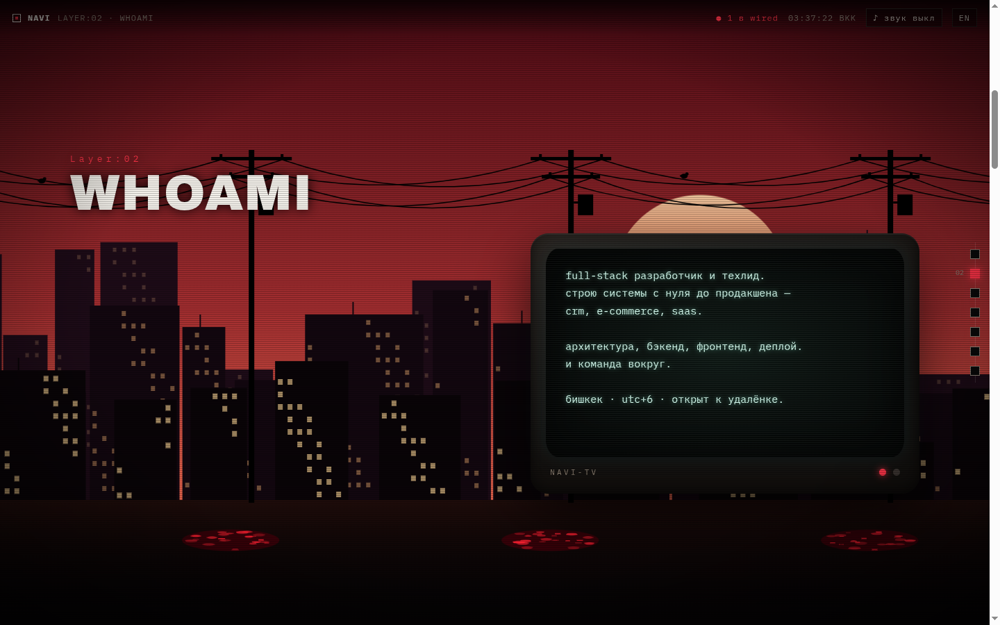
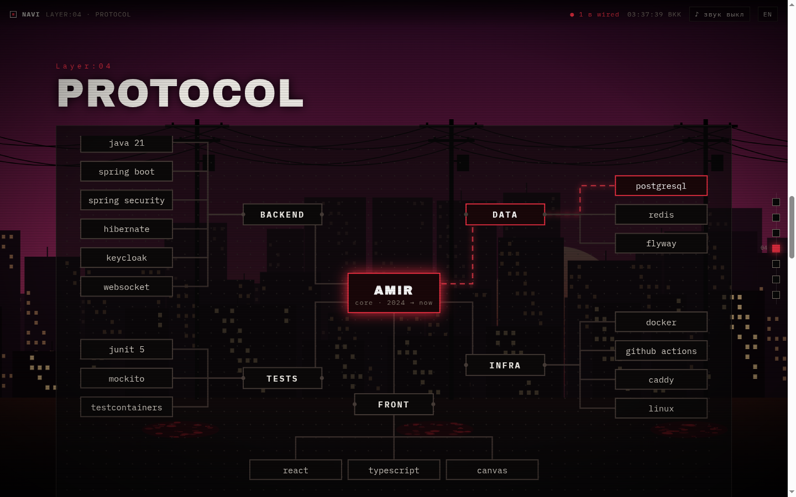
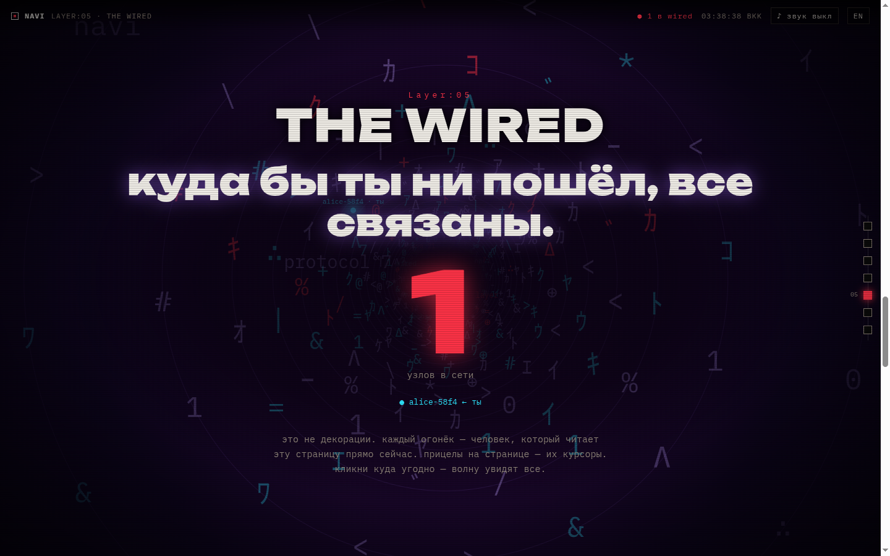

<div align="center">


# NAVI

**a portfolio you walk through, like an episode of *serial experiments lain*.**
scroll down a street at dusk, tune an old tv, trace the circuit, then fall into the wired —
where every light is a real person reading the page right now.

</div>

---

### `layer:01` — what happens here

| layer | what you do |
|---|---|
| **01 · present day** | scroll to walk down the street. buildings parallax, windows flicker. touch the power lines and they spark and crackle. get close and the crows fly away. the red shadows breathe. |
| **02 · whoami** | a street crt types out who i am. |
| **03 · channels** | projects are tv channels. turn the knob (drag, wheel, arrows) and get static, a channel blip, then *on air*. |
| **04 · protocol** | the stack as a pcb. hover a component and current runs to the core and shows which projects it powers. |
| **05 · the wired** | the scene tears and you drop into a tunnel of glyphs. live visitors float in it as nodes. |
| **06 · traces** | leave a message. it is stored, pushed to everyone and drifts through the wired. |
| **07 · navi** | a terminal for those who prefer a prompt: `help`, `nodes`, `node 01`, `who`, `cv`, `trace`, `lain`… |

**multiplayer, everywhere.** other visitors' cursors are rendered on top of the page as ghosts with their handles. click anywhere and everyone sees your ripple.
**sound.** a synthesized power-line hum, sparks, tv static and a descent drone, all generated live with webaudio. no audio files.
**secrets.** type `lain` anywhere, or use the konami code.

<table>
<tr>
<td></td>
<td></td>
</tr>
<tr>
<td></td>
<td></td>
</tr>
</table>

### `layer:02` — protocol

```text
backend   java 21 · spring boot 4 · spring websocket · spring data jpa · flyway
data      postgresql 16
front     typescript · canvas 2d · webaudio · vite — no frameworks, no images
tests     junit 5 · mockito · testcontainers (real postgres + real websocket clients)
ship      one docker image · github actions
```

### `layer:03` — how it works

```
browser ──ws /wired──▶ WiredSocketHandler ──▶ PresenceService
                                                 ├─ WELCOME / JOINED / LEFT   (presence)
                                                 └─ CURSOR / PING             (relayed to everyone else)
browser ──POST /api/traces──▶ TraceController ──▶ TraceService ──▶ postgres
                                                     └──▶ PresenceService.broadcast(TRACE)
```

- **presence** lives in memory. every session gets a handle (`lain-3f2a`, `knights-09bc`) and is wrapped in `ConcurrentWebSocketSessionDecorator`, so a slow client can't stall a broadcast. the visitor count is capped.
- **signals** (cursor, ping) are validated (coordinates normalized to `0..1`, payload size limited, unknown types dropped) and throttled per connection: 50 ms for a cursor, 400 ms for a ping. the sender never gets its own echo.
- **traces** are cleaned of control characters, limited in length, links are rejected, one per minute per ip. the client escapes every string, so no html is ever rendered.
- **the scene** is a single 2d canvas: procedural skyline, catenary wires with hit-testing, particles, a glyph tunnel with mouse-steered perspective, all driven by scroll progress.
- **tests** start postgres in a container, open two real websocket clients and check presence, broadcast and rate limits end to end.

### `layer:04` — run it

```bash
cp .env.example .env              # set DB_PASSWORD
docker compose --profile app up --build
open http://localhost:8080
```

development:

```bash
docker compose up -d postgres
./mvnw spring-boot:run                # api + websocket on :8080
cd frontend && npm i && npm run dev   # vite on :5199, proxies /api and /wired
./mvnw verify                         # unit + integration tests (needs docker)
```

| variable | default | |
|---|---|---|
| `DB_URL` / `DB_USERNAME` / `DB_PASSWORD` | `jdbc:postgresql://localhost:5452/navi` / `navi` / — | postgres |
| `NAVI_TRACE_MAX_LENGTH` | `140` | trace length |
| `NAVI_TRACE_COOLDOWN` | `60s` | one trace per ip per cooldown |
| `NAVI_TRACE_FEED_SIZE` | `50` | traces in the feed |
| `NAVI_WIRED_MAX_VISITORS` | `300` | concurrent websocket sessions |
| `NAVI_WIRED_CURSOR_INTERVAL` | `50ms` | min interval between cursor updates |
| `NAVI_WIRED_PING_INTERVAL` | `400ms` | min interval between pings |
| `NAVI_ALLOWED_ORIGINS` | `*` | websocket origin patterns |

### `layer:05` — license

source-available under the [PolyForm Noncommercial License 1.0.0](LICENSE).
you can read, run, learn from and modify it for any **noncommercial** purpose, as long as you keep the `Required Notice` with my name and a link to this repo. selling it or using it commercially is not allowed. for anything else, [write to me](https://www.linkedin.com/in/suleimanovamir/).

---

<div align="center">

made by **[amir suleimanov](https://www.linkedin.com/in/suleimanovamir/)** · full-stack developer · bishkek

*close the world, open the nExt.*

</div>
